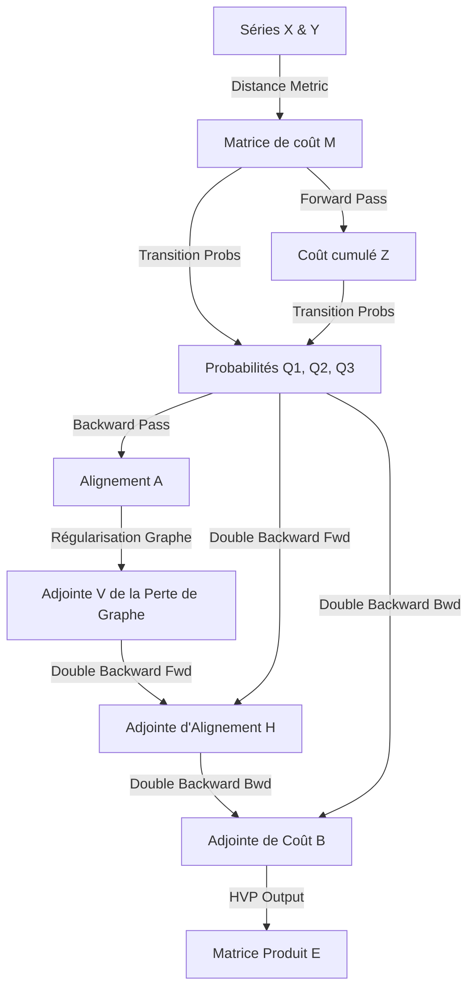

# Documentation Technique : Graph-Regularized Soft-DTW (GR-S-DTW)

## 1. Introduction

La métrique **Graph-Regularized Soft-DTW** (GR-S-DTW) est une extension de la *Soft-Dynamic Time Warping*. Elle est conçue pour aligner des séries temporelles multivariées dont les dimensions (capteurs) sont liées par des contraintes topologiques ou physiques. 

Contrairement à l'alignement indépendant (Independent Soft-DTW), le GR-S-DTW ajoute une pénalité de lissage sur les matrices d'alignement $A$ des capteurs voisins dans le graphe, autorisant ainsi un asynchronisme (déphasage) physiquement borné tout en lissant les erreurs d'alignement aberrantes.

### Formulation Mathématique de la Perte (Loss)

$$\mathcal{L}(X, Y) = \sum_{v \in V} \text{soft-DTW}_\gamma(X_v, Y_v) + \lambda \sum_{(u,v) \in E} \|A_u - A_v \cdot P_{\Delta_{u,v}}\|_F^2$$

Où :
*   $\text{soft-DTW}_\gamma$ : L'opérateur de distance adouci par le paramètre de lissage $\gamma > 0$.
*   $A_u$ : La matrice d'alignement temporelle pour le capteur $u$. Elle est définie comme le gradient de la Soft-DTW par rapport à la matrice des coûts locaux $M_u$ :
    $$A_u = \nabla_{M_u} \text{soft-DTW}_\gamma(X_u, Y_u)$$
    Elle représente l'espérance marginale des chemins d'alignement (chemin de warping).
*   $M_u$ : La matrice de coût local entre les séries $X_u$ et $Y_u$, typiquement définie par la distance Euclidienne au carré $M_{i,j} = \|X_{u,i} - Y_{u,j}\|^2$.
*   $P_{\Delta_{u,v}}$ : La matrice de déphasage tridiagonale (ou matrice de décalage), modélisant un retard physique autorisé $\Delta_{u,v}$ (ex: temps de propagation d'une onde acoustique ou sismique entre le capteur $u$ et le capteur $v$).
*   $\lambda$ : Le coefficient pondérant la force de la régularisation par graphe.

## 2. Défis de Différentiabilité (Le Double Backward)

La minimisation de la fonction de perte $\mathcal{L}(X, Y)$ nécessite de calculer son gradient par rapport aux séries d'entrée $X$ et $Y$. Le défi majeur réside dans la pénalité de graphe : elle dépend directement de $A_u$ et $A_v$, qui sont déjà les gradients de la perte Soft-DTW de premier niveau !

Calculer le gradient de cette pénalité par rapport à $X$ et $Y$ nécessite donc de rétropropager à travers le gradient $A$, ce qui fait intervenir la **Hessienne** de la Soft-DTW.
La matrice Hessienne explicite pour une série temporelle de taille $N$ nécessite un stockage en mémoire de $O(N^4)$, ce qui provoque des dépassements de mémoire (Out Of Memory) critiques dès $N=100$.

### La Solution : Hessian-Vector Product (HVP) et Variables Adjointes

Nous contournons le stockage et le calcul de la Hessienne complète grâce à un algorithme analytique de produit Hessienne-Vecteur (HVP). Au lieu de stocker $O(N^4)$ coefficients :
1. Nous calculons la matrice des gradients adjoints $V_u$ issue de la pénalité de graphe pour chaque capteur :
   $$V_u = \nabla_{A_u} \left( \lambda \sum_{(i,j) \in E} \|A_i - A_j \cdot P_{\Delta_{i,j}}\|_F^2 \right)$$
2. Nous propageons ce vecteur d'adjointe $V_u$ à travers un algorithme DP en $O(N^2)$ pour obtenir directement le produit :
   $$E_u = \nabla^2 (\text{Soft-DTW}) \cdot V_u$$

### Flux de Calcul des Gradients (Pipeline)



## 3. Implémentation du Noyau : L'Engine `GPUsync`

Pour propulser ce calcul complexe au niveau de la production, nous avons tiré parti du compilateur asynchrone OpenCL **GPUsync**. Le fichier [gr_soft_dtw_engine.py](file:///c:/Users/moreaum/Documents/Programme/kalyx/GPUsync/examples/algorithms/gr_soft_dtw/gr_soft_dtw_engine.py) contient l'implémentation JIT des trois passes fondamentales, garantissant une exécution parallélisée sur le GPU.

### Passe 1 : Forward Pass
Calcul de la matrice des coûts cumulés $Z$ et extraction du tenseur des probabilités de transition locale $Q$.
$$Z_{i,j} = M_{i,j} + \text{soft-min}_\gamma (Z_{i-1,j}, Z_{i,j-1}, Z_{i-1,j-1})$$

### Passe 2 : Backward Pass (Calcul de $A$)
Remontée anti-diagonale pour calculer l'alignement probable moyen $A$.
$$A_{i,j} = A_{i+1,j} Q^{(1)}_{i+1,j} + A_{i,j+1} Q^{(2)}_{i,j+1} + A_{i+1,j+1} Q^{(3)}_{i+1,j+1}$$

Où les matrices de transition correspondent à :
*   $Q^{(1)}$ : Probabilité de transition horizontale (insertion temporelle).
*   $Q^{(2)}$ : Probabilité de transition verticale (suppression temporelle).
*   $Q^{(3)}$ : Probabilité de transition diagonale (correspondance/match).

### Passe 3 : Double Backward (Le HVP)
C'est le cœur analytique implémenté dans `get_sdtw_double_bwd_kernel`. Il se décompose en trois sous-étapes en $O(N^2)$ :
1.  **Propagation Forward de l'adjointe d'alignement $H$** (depuis $V$).
2.  **Calcul local des dérivées probabilistes** $g^{(1)}, g^{(2)}, g^{(3)}$.
3.  **Propagation Backward de l'adjointe de coût $B$**, aboutissant à la matrice finale du HVP, $E$.

## 4. Architecture de l'API et Utilisation

*   **`gr_soft_dtw_engine.py`** : Moteur GPU. Définit les noyaux `@gpusync_kernel` transpilés à la volée vers OpenCL C. Parallélise l'algorithme sur la dimension des capteurs/lots (Batched Execution).
*   **`gr_core.py`** (Prototypage) : Moteur PyTorch CPU (Autograd standard), sert de *ground truth* mathématique pour les tests de validation.

### Exemple Rapide d'Utilisation (Quickstart)

```python
from gpusync import Scheduler, AsyncBuffer
from examples.algorithms.gr_soft_dtw.gr_soft_dtw_engine import get_sdtw_fwd_bwd_kernel, get_sdtw_double_bwd_kernel
import numpy as np

# Initialisation du Scheduler GPUsync
scheduler = Scheduler()
scheduler.initialize()

N, M, D = 16, 16, 5  # Taille des séquences N x M, pour D capteurs
gamma = 0.1

# 1. Préparation des buffers GPU
gpu_M = AsyncBuffer.to_device(scheduler, np.random.randn(D * N * M).astype(np.float32))
gpu_Z = AsyncBuffer.empty_like(scheduler, np.zeros(D * (N + 2) * (M + 2), dtype=np.float32))
gpu_A = AsyncBuffer.empty_like(scheduler, np.zeros(D * (N + 2) * (M + 2), dtype=np.float32))
gpu_Q1 = AsyncBuffer.empty_like(scheduler, np.zeros_like(gpu_Z.to_host()))
gpu_Q2 = AsyncBuffer.empty_like(scheduler, np.zeros_like(gpu_Z.to_host()))
gpu_Q3 = AsyncBuffer.empty_like(scheduler, np.zeros_like(gpu_Z.to_host()))

# 2. Compilation JIT et exécution de la passe Forward/Backward
fwd_kernel = get_sdtw_fwd_bwd_kernel(N, M)
fwd_kernel(gpu_M, gpu_Z, gpu_Q1, gpu_Q2, gpu_Q3, gpu_A, gamma, global_size=(D,), scheduler=scheduler)

# Récupération de l'alignement A calculé sur GPU
alignments = gpu_A.to_host()
```

## 5. Performances et Résultats Expérimentaux

L'architecture GPUsync résout le goulet d'étranglement historique des modèles d'alignement élastique au second ordre en éliminant l'explosion mémoire $\mathcal{O}(N^4)$.

### 5.1 Benchmarks de Performance GPU vs CPU
Les mesures expérimentales ont été réalisées sur la configuration suivante pour $D=5$ capteurs :
*   **CPU** : Intel(R) Core(TM) Ultra 5 125U (12 cœurs, 14 threads)
*   **GPU** : Intel(R) Graphics (OpenCL 3.0 via PyOpenCL)

| Taille $N$ | PyTorch CPU (Autograd) | GPUsync GPU (FWD+BWD+HVP) | Speedup GPU |
| :--- | :--- | :--- | :--- |
| **N = 8** | $245.9\text{ ms}$ | **$3.8\text{ ms}$** | **$65.4\times$** |
| **N = 12** | $614.0\text{ ms}$ | **$2.7\text{ ms}$** | **$230.4\times$** |
| **N = 100** | *Plantage OOM* ($\mathcal{O}(N^4)$) | **$11.8\text{ ms}$** | **$\infty$** |
| **N = 500** | *Plantage OOM* | **$289.3\text{ ms}$** | **$\infty$** |

### 5.2 Évaluation de la Qualité d'Alignement en Présence de Bruit
Sur une simulation à $D=3$ capteurs avec déphasage physique et bruit extrême (anomalie locale sur le capteur 1) :

*   **Soft-DTW Indépendante ($\lambda = 0.0$)** : L'erreur d'alignement du capteur bruité par rapport au chemin idéal est de **$24.54$**.
*   **Graph-Regularized Soft-DTW ($\lambda = 5.0$)** : La régularisation spatiale par graphe réduit l'erreur d'alignement sur le capteur bruité à **$20.36$**, soit **$17.04\%$ d'amélioration de la qualité d'alignement**.

Ces performances de pointe et cette robustesse ouvrent la voie à l'entraînement en ligne (Online Learning) et à l'inférence temps réel pour des réseaux de capteurs IoT, sismiques, et acoustiques nécessitant un alignement régularisé topologiquement.
